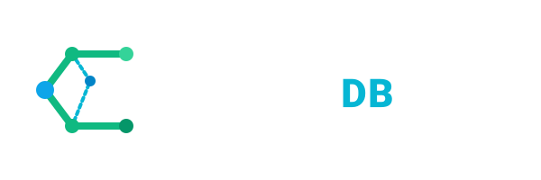
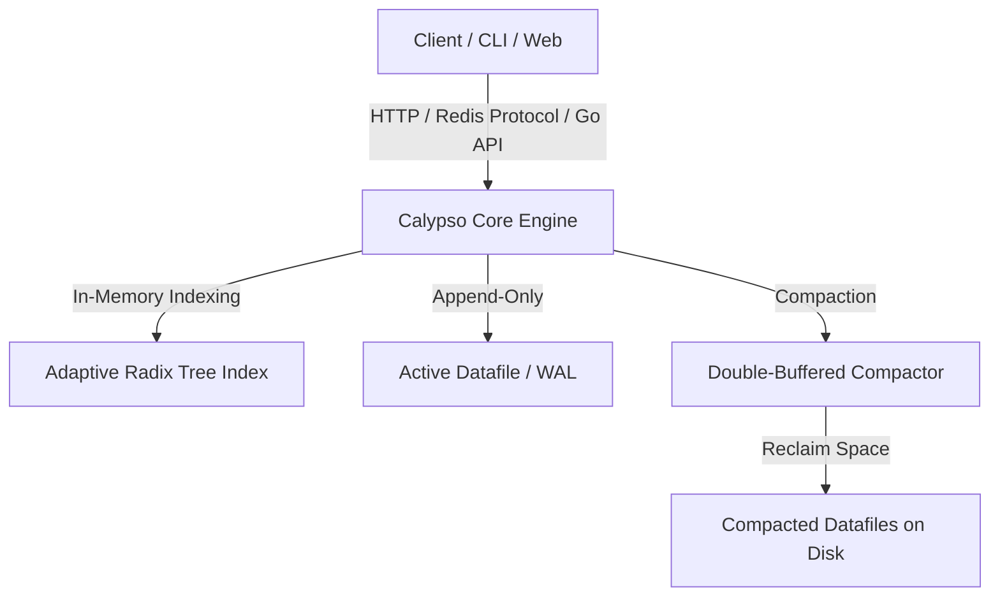

<div align="center">



[](https://golang.org)
[](#-redis-protocol-compatibility-calypsod)
[](LICENSE)
[](#)

**A key-value storage engine in Go implementing a log-structured Bitcask design with an Adaptive Radix Tree index.**

[Features](#-what-is-calypsodb) • [Architecture](#-architectural-modules) • [Building](#-building-and-installation) • [Usage](#-usage-guide) • [Benchmarks](#-benchmarks)

---
</div>

## What is CalypsoDB?

While standard Bitcask (from the Riak design paper) offers fast sequential writes and single disk-seek reads, it has distinct design trade-offs, such as in-memory key directories that scale linearly with the key count. **CalypsoDB** introduces adaptations designed for practical, single-node key-value storage use:

*   **Adaptive Radix Tree (ART) Index**: Standard Bitcask implementations typically maintain an in-memory hash map (keydir). This consumes substantial memory and prevents ordered scans. CalypsoDB employs a memory-efficient **Adaptive Radix Tree (ART)** (`github.com/plar/go-adaptive-radix-tree`). This enables ordered **prefix scans** and **range queries** (`Range`, `Scan`, `SiftRange`).
*   **Time-to-Live (TTL) Support**: Provides support for setting an expiry duration on key-value pairs (`PutWithTTL`). CalypsoDB manages a separate thread-safe TTL index and runs background compaction to identify and clean up expired records.
*   **Redis Protocol Compatibility (`calypsod`)**: Exposes a Redis-compatible TCP interface built on `github.com/tidwall/redcon`. You can query and manage CalypsoDB using **standard Redis clients** (`redis-cli`, or standard Go/Python/Node Redis libraries) out of the box.
*   **Web UI Dashboard & REST Server (`apid`)**: Integrates an HTTP REST API server paired with a browser-based template dashboard to browse, insert, update, and delete key-value pairs.
*   **Double-Buffered Compaction (`Merge`)**: Implements a background merge and compaction process using a double-buffered temporary database pattern. This design reclaims disk space from stale or deleted records without blocking active reads or incoming writes.

---

## Project Status

CalypsoDB is currently experimental and under active development.
APIs and storage formats may change between releases.

---

## Architectural Modules

CalypsoDB is structured into modular sub-systems:



*   **Octopus**: The internal engine core responsible for entry codecs, metadata handling, options configuration, versioning, and abstract index definitions.
*   **Dolphin**: The visual administration frontend. A server dashboard serving direct HTML templates for managing key-value stores.
*   **Seagull**: The gateway services housing the main binaries:
    *   `calypso` - The standalone CLI management tool.
    *   `calypsod` - The Redis-protocol-compatible daemon.
    *   `apid` - The combined REST API and template web interface.

---

## Building and Installation

### Prerequisites
*   Go **1.25+** installed.
*   A standard Unix build environment (supporting `make`).

### Build via Makefile

Run the default target to clean, generate assets, and build all binaries:

```bash
make
```

This will produce three statically linked binaries inside the `./bin/` directory:
*   `bin/calypso` - CLI Tool
*   `bin/calypsod` - Redis Protocol Daemon
*   `bin/apid` - REST API & Web Dashboard Server

### Build via Go Compiler

If you don't have `make` installed, compile the packages manually using:

```bash
go build -o bin/calypso ./seagull/calypso/...
go build -o bin/calypsod ./seagull/calypsod/...
go build -o bin/apid ./seagull/apid/...
```

---

## Usage Guide

### 1. Embedded Go Library API
Integrate CalypsoDB directly into your Go application:

```go
package main

import (
	"fmt"
	"log"
	"time"

	calypso "github.com/calypsodb/calypso"
)

func main() {
	// Open or create a database
	db, err := calypso.Open("./my_db")
	if err != nil {
		log.Fatalf("Failed to open database: %v", err)
	}
	defer db.Close()

	// 1. Standard Put and Get
	err = db.Put([]byte("name"), []byte("CalypsoDB"))
	val, err := db.Get([]byte("name"))
	fmt.Printf("Get 'name': %s\n", val) // CalypsoDB

	// 2. Put with Time-to-Live (TTL)
	err = db.PutWithTTL([]byte("session_token"), []byte("xyz123"), 5*time.Second)

	// 3. Prefix Scan (powered by Radix Tree)
	err = db.Scan([]byte("user:"), func(key []byte) error {
		val, _ := db.Get(key)
		fmt.Printf("Key: %s, Value: %s\n", key, val)
		return nil
	})
}
```

### 2. The `calypso` Command-Line Tool
Interact with your database data files directly through the command line:

```bash
# Set a key-value pair
./bin/calypso put ./my_db "greeting" "Hello Universe"

# Get the value
./bin/calypso get ./my_db "greeting"

# Delete a key
./bin/calypso del ./my_db "greeting"

# Get database statistics
./bin/calypso stats ./my_db
```

### 3. Redis Protocol Compatibility (`calypsod`)
Start the Redis-compatible TCP server daemon:

```bash
# Start the daemon on port 6379, writing to ./my_db
./bin/calypsod --bind :6379 --dbpath ./my_db
```

Query the database using standard Redis clients:

```bash
# Connect using redis-cli
redis-cli -p 6379

127.0.0.1:6379> PING
PONG
127.0.0.1:6379> SET user:1 "Alice"
OK
127.0.0.1:6379> GET user:1
"Alice"
127.0.0.1:6379> KEYS
1) "user:1"
127.0.0.1:6379> EXISTS user:1
(integer) 1
127.0.0.1:6379> DEL user:1
(integer) 1
```

### 4. REST API & Web Dashboard Daemon (`apid`)
Start the API and Web administration dashboard server:

```bash
# Start the server (default port 7777)
./bin/apid --dbpath ./my_db
```

*   **REST API endpoints**:
    *   `GET http://localhost:7777/get/{key}` - Retrieve key value.
    *   `POST http://localhost:7777/set/{key}/{value}` - Write key-value pair.
*   **Web Dashboard**: 
    *   Visit `http://localhost:7777/browse` in your browser to view, search, insert, and manage records visually.

---

## Benchmarks

To evaluate the engine's performance relative to alternative designs (such as B-trees, SQLite, or alternative Bitcask implementations), you can execute the included benchmark suite:

```bash
# Execute all benchmark suites
go test -v ./test_bench/...
```

### Preliminary Observations
Because Bitcask uses an append-only log-structured design, write performance is bound primarily by sequential disk I/O (subject to chosen `fsync` configuration options), while reads guarantee a maximum of one disk seek for values not cached in memory. Radix tree operations in memory execute in $O(k)$ time, where $k$ is key length.

Actual performance metrics depend heavily on underlying hardware (SSD vs. HDD), value size distributions, concurrency levels, and whether `fsync` is called synchronously on every write or deferred periodically. Run the benchmarks locally to generate metrics specific to your target environment.

---

## License
CalypsoDB is open-source software licensed under the [MIT License](LICENSE).