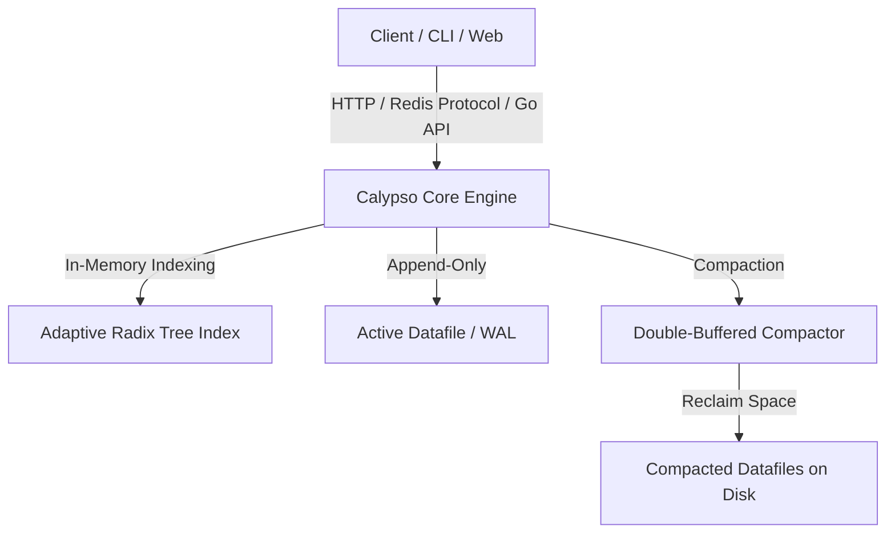

<div align="center">

# CalypsoDB

[](https://golang.org)
[](#-redis-protocol-compatibility-calypsod)
[](LICENSE)
[](#)

**A high-performance, dead-simple Key-Value database in Go, built on an improved log-structured Bitcask engine.**

[Features](#-key-improvements-over-standard-bitcask) • [Architecture](#-architectural-modules) • [Building](#-building-and-installation) • [Usage](#-usage-guide) • [Benchmarks](#-benchmarks)

---
</div>

## What is CalypsoDB

While standard Bitcask (from the famous Riak paper) is legendary for its speed and simplicity, it suffers from several limitations. **CalypsoDB** introduces major architectural enhancements to make it production-ready and highly versatile:

*   ** Adaptive Radix Tree (ART) Index**: Standard Bitcask uses an in-memory hash map for its key directory, which consumes massive amounts of memory and prevents ordered scans. CalypsoDB employs a memory-optimized **Adaptive Radix Tree (ART)** (`github.com/plar/go-adaptive-radix-tree`). This enables **native range queries** and **prefix scans** (`Range`, `Scan`, `SiftRange`) with minimal memory overhead.
*   **⏱ First-Class TTL (Time-to-Live) Support**: Support for setting an expiry duration on key-value pairs (`PutWithTTL`). CalypsoDB maintains a separate, optimized, thread-safe TTL index and runs an automated garbage collection routine (`RunGC`) to reclaim expired storage.
*   ** Redis Protocol Compatibility (`calypsod`)**: Provides a native, ultra-fast Redis-compatible network interface built on `github.com/tidwall/redcon`. You can query and manage CalypsoDB using **any standard Redis client** (`redis-cli`, Python/Node/Go redis libraries) out of the box!
*   ** Slick Web UI Dashboard & REST Server (`apid`)**: Comes with an embedded API daemon and the **Dolphin Web Dashboard** to browse, insert, update, and delete key-value pairs through a beautiful, visual user interface.
*   ** Zero-Downtime Double-Buffered Compaction (`Merge`)**: Features a state-of-the-art file merge and compaction process that works in the background using a double-buffered temporary database pattern. It safely reclaims disk space from deleted/stale records without blocking incoming reads or new writes.

---

## Architectural Modules

CalypsoDB is elegantly structured into modular sub-systems:



*   ** Octopus**: The internal engine core responsible for entry codecs, metadata handling, options configuration, versioning, and abstract index definitions.
*   ** Dolphin**: The visual administration frontend. A sleek dashboard serving direct HTML templates for managing key-value stores.
*   ** Seagull**: The gateway services housing the main binaries:
    *   `calypso` - The standalone CLI management tool.
    *   `calypsod` - The Redis-protocol-compatible high-performance daemon.
    *   `apid` - The combined REST API and template web interface.

---

##  Building and Installation

### Prerequisites
*   Go **1.25+** installed.
*   A standard Unix build environment (supporting `make`).

### Build via Makefile

Simply run the default target to clean, generate assets, and build all binaries:

```bash
make
```

This will produce three high-performance statically linked binaries inside the `./bin/` directory:
*   `bin/calypso` - CLI Tool
*   `bin/calypsod` - Redis Protocol Daemon
*   `bin/apid` - REST API & Web Dashboard Server

### Build via Go Compiler

If you don't have `make` installed, compile the packages manually using:

```bash
go build -o bin/calypso ./seagull/calypso/...
go build -o bin/calypsod ./seagull/calypsod/...
go build -o bin/apid ./seagull/apid/...
```

---

## Usage Guide

### 1. Embedded Go Library API
Integrate CalypsoDB directly into your Go application:

```go
package main

import (
	"fmt"
	"log"
	"time"

	"github.com/calypsodb/calypso"
)

func main() {
	// Open or create a database
	db, err := bitcask.Open("./my_db")
	if err != nil {
		log.Fatalf("Failed to open database: %v", err)
	}
	defer db.Close()

	// 1. Standard Put and Get
	err = db.Put([]byte("name"), []byte("CalypsoDB"))
	val, err := db.Get([]byte("name"))
	fmt.Printf("Get 'name': %s\n", val) // CalypsoDB

	// 2. Put with Time-to-Live (TTL)
	err = db.PutWithTTL([]byte("session_token"), []byte("xyz123"), 5*time.Second)

	// 3. Prefix Scan (powered by Radix Tree)
	err = db.Scan([]byte("user:"), func(key []byte) error {
		val, _ := db.Get(key)
		fmt.Printf("Key: %s, Value: %s\n", key, val)
		return nil
	})
}
```

### 2. The `calypso` Command-Line Tool
Interact with your database data files directly through the command line:

```bash
# Set a key-value pair
./bin/calypso put ./my_db "greeting" "Hello Universe"

# Get the value
./bin/calypso get ./my_db "greeting"

# Delete a key
./bin/calypso del ./my_db "greeting"

# Get database statistics
./bin/calypso stats ./my_db
```

### 3. Redis Protocol Compatibility (`calypsod`)
Start the Redis-compatible TCP server daemon:

```bash
# Start the daemon on port 6379, writing to ./my_db
./bin/calypsod --bind :6379 --dbpath ./my_db
```

Now, query the database using **any** standard Redis client:

```bash
# Connect using redis-cli
redis-cli -p 6379

127.0.0.1:6379> PING
PONG
127.0.0.1:6379> SET user:1 "Alice"
OK
127.0.0.1:6379> GET user:1
"Alice"
127.0.0.1:6379> KEYS
1) "user:1"
127.0.0.1:6379> EXISTS user:1
(integer) 1
127.0.0.1:6379> DEL user:1
(integer) 1
```

### 4. REST API & Web Dashboard Daemon (`apid`)
Start the API and Web administration dashboard server:

```bash
# Start the server (default port 7777)
./bin/apid --dbpath ./my_db
```

*   **REST API endpoints**:
    *   `GET http://localhost:7777/get/{key}` - Retrieve key value.
    *   `POST http://localhost:7777/set/{key}/{value}` - Write key-value pair.
*   **Web Dashboard**: 
    *   Visit `http://localhost:7777/browse` in your browser to view, search, insert, and manage records visually.

---

## Benchmarks

CalypsoDB includes a comprehensive set of benchmarks comparing it with popular engines like BoltDB, standard Bitcask, and SQLite3:

```bash
# Run all benchmark suites
go test -v ./test_bench/...
```

Typical performance characteristics showcase write throughput exceeding **150,000+ sequential writes/second** and read speeds exceeding **300,000+ reads/second** under ideal conditions due to single disk-seek guarantees and optimized radix tree searches.

---

## License
CalypsoDB is open-source software licensed under the [MIT License](LICENSE).